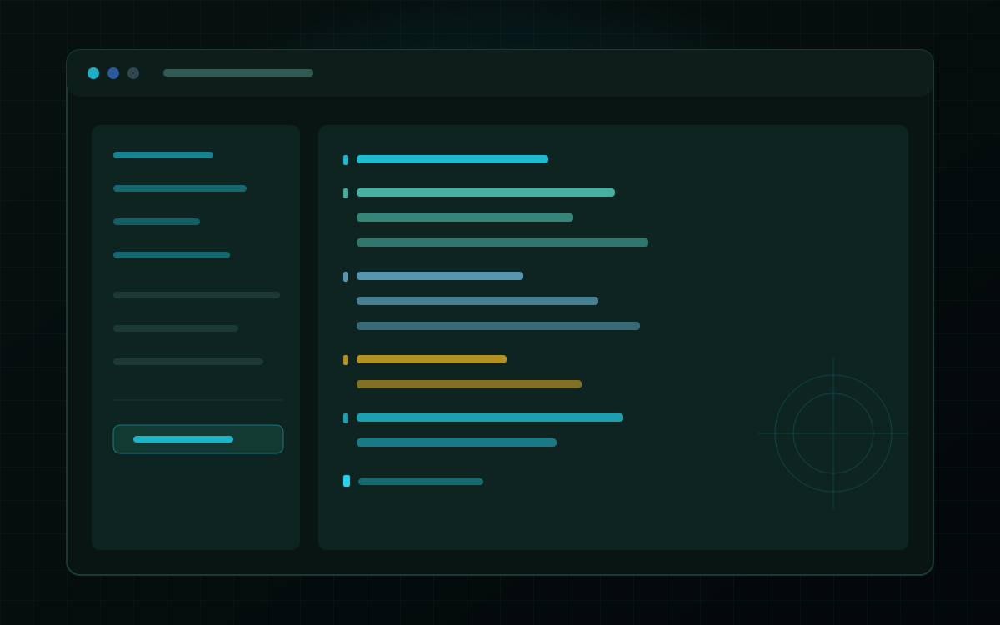

# Sentinel Recon Toolkit

A reconnaissance automation dashboard built by **SYFERON** for authorized security assessments. It consolidates subdomain discovery, port scanning, service fingerprinting and header review into one reviewable, auditable report — so assessors spend time on analysis instead of spreadsheets.



> **Ethical use:** This demo simulates recon output in the browser. It does not scan or contact any external host. Only test systems you are explicitly authorized to assess.

## Run locally

```cmd
set "PATH=C:\Program Files\nodejs;%PATH%"
cd projects\sentinel-recon-toolkit
npm install
npm run dev
```

Open the URL Vite prints (default `http://localhost:5175`).

## Try it

1. Set a target domain and confirm it is in scope.
2. Toggle the modules you want to run.
3. Click **Run scan** to watch a simulated run log and progress.
4. Review the findings table and **Export JSON** for a structured report.

## Build

```cmd
npm run build
```

## Stack

React 19 · TypeScript · Vite 8 · browser-only simulation (no network calls).

## Part of the SYFERON portfolio

One of four published projects: Atlas Analytics, Relay API Platform, Sentinel Recon Toolkit and Signal Threat Intelligence. All demos carry the SYFERON watermark.

## License

MIT — see [LICENSE](./LICENSE).
